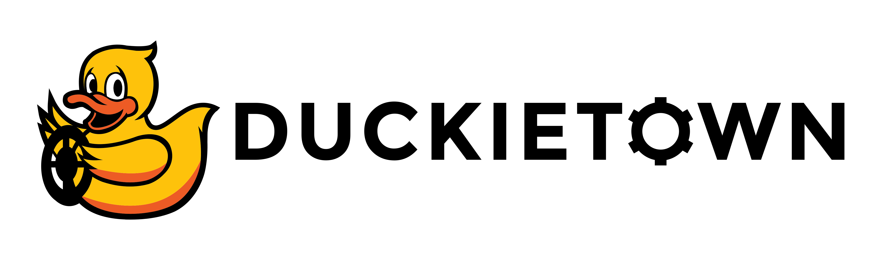

<p align="center">
<a href="https://duckietown.com"></a>
</p>

# **Learning Experience (LX): Lane Following**

# About these activities

This learning experience is designed to combine the knowledge we have gained from several of the simpler exercises into one more complex lane following demo, running on the ROS 2 (Jazzy) Duckietown stack.

It also serves as an introduction to the [`dts devel`](https://docs.duckietown.com/ente/duckietown-manual/70-developer-manual/dtproject/creating-demos.html) API which you can use to create new behaviors in Duckietown.

This learning experience is provided by the Duckietown team and can be run on virtual and physical Duckiebots. Visit us at the
[Duckietown Website](https://www.duckietown.com) for more learning materials, documentation, and demos.

For guided setup instructions, lecture content, and more related to this LX, see [the EdX course page](https://duckietown.com/self-driving-cars-with-duckietown-mooc/).


# Instructions

**NOTE:** All commands below are intended to be executed from the root directory of this exercise (i.e., the directory containing this README).


## 1. Make sure your exercise is up-to-date

Update your exercise definition and instructions,

    git pull upstream <your upstream branch>

**NOTE:** Example instructions to fork a repository and configure to pull from upstream can be found in the [duckietown-lx repository README](https://github.com/duckietown/duckietown-lx/blob/mooc2022/README.md).


**NEW FOR THIS LX**: You also need to clone the [`dt-ros2-core`](https://github.com/duckietown/dt-ros2-core) repository, which is a "submodule" of this one. It contains the ROS 2 lane following stack (line detector, ground projection, lane filter, lane controller, FSM and LED emitter). To do so execute in the base directory of this repository:

    git submodule init
    git submodule update

You should now see the `dt-ros2-core` repo inside the `packages` folder (`packages/dt-ros2-core`).

## 2. Make sure your system is up-to-date

- 💻 Always make sure your Duckietown Shell is updated to the latest version. See [installation instructions](https://github.com/duckietown/duckietown-shell)

- 💻 Update the shell commands: `dts update`

- 💻 Update your laptop/desktop: `dts desktop update`

- 🚙 Update your Duckiebot: `dts duckiebot update ROBOTNAME` (where `ROBOTNAME` is the name of your Duckiebot chosen during the initialization procedure.)


## 3. Bring up the ROS 2 stack on your robot

The lane following demo runs on the ROS 2 robot stack. Start it explicitly, both on a real Duckiebot and on a virtual one:

    dts stack up -H ROBOTNAME ros2/duckiebot
    dts stack up -H ROBOTNAME ros2-core/default

The first stack provides the ROS 2 drivers (camera, wheels, encoders, LEDs); the second one provides the car interface (`kinematics_node`, `car_cmd_switch_node`, `joy_mapper_node`) that turns `v, omega` commands into wheel commands.

For a **virtual robot** in the Duckiematrix, create and start it first (virtual robots still autoboot the ROS 1 stack; the ROS 2 stack is started explicitly for now):

    dts duckiebot virtual create --type duckiebot --configuration DB21J ROBOTNAME
    dts duckiebot virtual start ROBOTNAME
    dts stack up -H ROBOTNAME ros2/duckiebot
    dts stack up -H ROBOTNAME ros2-core/default

The Duckiematrix itself is started as usual (`dts matrix run ...`, `dts matrix attach ...`), see the [first notebook](./notebooks/00_DTS_devel_API.ipynb).


## 4. Work on the exercise

### Launch the code editor

Open the code editor by running the following command,

```
dts code editor
```

Wait for a URL to appear on the terminal, then click on it or copy-paste it in the address bar of your browser to access the code editor. The first thing you will see in the code editor is this same document, you can continue there.

The editor ships with ROS 2 (Jazzy) and the Duckietown messages: notebooks can connect to your robot (see the `RosSession(ROBOT_NAME)` cells) and a terminal inside the editor has `ros2 topic list`, `ros2 topic echo`, `ros2 node list`, `ros2 param list/get/set` and `ros2 service call`. A terminal connects to the robot's zenoh router after you run `dt-ros2-connect ROBOTNAME` in it; notebooks connect with the `RosSession(ROBOT_NAME)` cell.


### Walkthrough of notebooks

**NOTE**: You should be reading this from inside the code editor in your browser.

Inside the code editor, use the navigator sidebar on the left-hand side to navigate to the
`notebooks` directory and open the first notebook.

Follow the instructions on the notebook and work through the notebooks in sequence.


### Building and running your code

Different from previous learning experiences, we will not use the `dts code` API to
build and run your code (the exercise image, i.e. `dts code workbench`, only prints a reminder). Instead we will use a more flexible API that you can use for building further demos yourself, `dts devel`. You are a developer now!

In short, from the `dt-ros2-core` submodule:

```bash
cd packages/dt-ros2-core
dts devel build -H ROBOTNAME
dts devel run -H ROBOTNAME -L lane-following
```

The `lane-following` launcher (`launchers/lane-following.sh`) runs `ros2 launch duckietown_demos lane_following.launch.py veh:=ROBOTNAME`, which starts `line_detector_node`, `ground_projection_node`, `lane_filter_node`, `lane_controller_node`, `fsm_node` and `led_emitter_node` in the robot's namespace.

This API is introduced in the [first notebook](./notebooks/00_DTS_devel_API.ipynb).

### Credits

The lane following behavior itself is the result of work of countless people who have contributed to the `dt-core` and `dt-ros2-core` repositories. A good percentage of the text describing the components was originally written by Adam Burhan and Azalée Robitaille the Université of Montréal.
